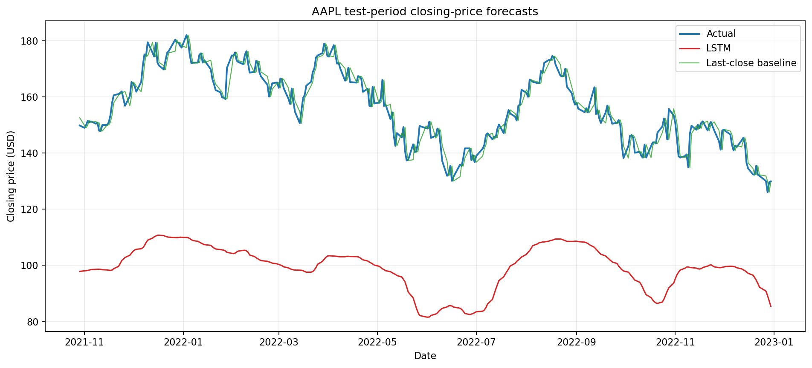

# LSTM Stock Market Forecasting

This repository contains a compact, notebook-based experiment for forecasting
daily closing prices with an LSTM. The model uses recent price history and a
small set of technical indicators. PCA is available as an optional input
transformation rather than being the main subject of the project.

The notebook is intentionally self-contained: it downloads the data, builds
the features, trains the network, and evaluates the result in one place.

## What the notebook does

The workflow is:

```text
market data -> technical indicators -> chronological split
            -> training-only scaling -> optional PCA -> sequences -> LSTM
```

By default, it downloads AAPL daily data and uses ten input features. The data
is split chronologically into training, validation, and test periods. Scaling
and PCA are fitted only on the training portion, which keeps information from
the validation and test periods out of preprocessing.

The final evaluation reports MAE, RMSE, and MAPE for both the LSTM and a simple
last-close baseline. That baseline is useful because a prediction line can look
convincing on a chart even when a much simpler method performs better.

## Example forecast

The figure below is generated by the committed notebook using its default
configuration. It shows predictions only for the held-out test period.



## PCA support

The main LSTM run uses the original standardized indicators by default:

```python
PCA_COMPONENTS = None
```

Set it to an integer to train the same model with PCA-transformed inputs:

```python
PCA_COMPONENTS = 4
```

Even when PCA is disabled for the main run, the notebook includes a small
four-component preview. It fits PCA on the training rows, displays the retained
variance, and shows the reduced input shape without running a second training
experiment.

## Running the notebook

Create an environment with Python 3.11 or newer, install the dependencies, and
open the notebook:

```bash
python -m pip install -r requirements.txt
jupyter notebook lstm_stock_market_forecasting.ipynb
```

The default settings are grouped near the top of the notebook:

```python
TICKER = "AAPL"
START_DATE = "2015-01-01"
END_DATE = "2023-01-01"
SEQUENCE_LENGTH = 60
PCA_COMPONENTS = None
```

Downloaded market data is cached in `data/`, so rerunning the notebook does not
request the same date range again. The cache is not committed.

## Notes

This is an experiment, not a trading system. Results depend on the selected
asset, date range, features, and random seed. Transaction costs, slippage, and
position sizing are outside the scope of the notebook.

## License

MIT. See [LICENSE](LICENSE).
